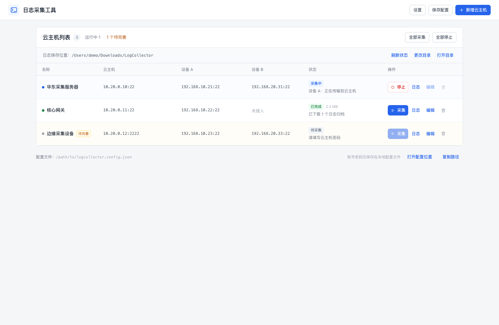

# 日志采集工具 · LogCollector

基于 **Go + Wails v2 + React + TypeScript** 的桌面日志采集工具。它面向「本地 → 云主机 → 设备 A（→ 设备 B）」链路，批量下发采集命令、等待结束标记，并把设备日志经云主机中转后保存到本地。

## 已实现能力

- **组合管理**：新增、编辑、删除组合；云主机与设备 A/B 的 IP、SSH 账号密码保存在一个本地 JSON 配置中。
- **设备 B 可选**：B 的 IP 留空即跳过；填写后经设备 A 建立 SSH 跳转通道，不要求云主机或本地直连 B。
- **链路跳转**：本地先 SSH 云主机，再从云主机 SSH 设备 A；访问 B 时经设备 A 的 direct-tcpip 通道完成跳转。等价于在 A 的终端执行 ssh 到 B，但全自动完成。
- **命令可编辑**：设备 A、B 分别配置采集命令、日志路径、结束标记和 SSH 端口。
- **结束标记判断**：程序在采集脚本末尾自动追加带退出码的标记回显，检测到标记后才打包和传输。
- **两段传输**：设备归档 → 云主机暂存目录 → 本地下载目录，全部使用内置 SSH/SFTP 通道。
- **批量与单控**：可同时采集多个组合，也可单独或全部停止；实时查看设备输出。
- **归档命名**：默认 <code>{combo}_{device}_{timestamp}.tar.gz</code>，支持模板。
- **便携分发**：Windows 最终只需 <code>LogCollector.exe</code> 和 <code>logcollector.config.json</code> 两个文件。

## 传输设计说明

需求中提到的「采集结束后 scp 到云主机，再从云主机 scp 到本地」，当前实现使用**内置 SFTP 客户端**完成两段传输。SFTP 与 SCP 都属于 SSH 文件传输能力；内置实现无需：

- 在设备或云主机安装 sshpass / 额外 scp 脚本；
- 在 Windows 本机安装 OpenSSH 客户端。

实际数据路径没有变化：**设备 → 云主机暂存目录 → 本地归档**。

## 从 GitHub 获取源码

~~~bash
git clone https://github.com/920171519/log-collect.git
cd log-collect
~~~

## 环境要求

- Go 1.23+
- Node.js 18+、npm
- Wails v2.17.0
- 目标 Windows 机器需有 WebView2 运行时（Windows 10/11 一般已内置）

安装 Wails：

~~~bash
go install github.com/wailsapp/wails/v2/cmd/wails@v2.17.0
wails doctor
~~~

开发启动：

~~~bash
cd frontend
npm install
cd ..
wails dev
~~~

macOS 构建：

~~~bash
wails build -clean
open build/bin/LogCollector.app
~~~

## Windows 构建与最终产物

### 一键脚本

在 Windows PowerShell 中进入项目根目录：

~~~powershell
go install github.com/wailsapp/wails/v2/cmd/wails@v2.17.0
powershell -ExecutionPolicy Bypass -File .\scripts\package-windows.ps1
~~~

产物目录：

~~~text
release/windows-amd64/
  LogCollector.exe
  logcollector.config.json
~~~

### 手动构建

~~~powershell
wails build -platform windows/amd64 -clean -trimpath
New-Item -ItemType Directory -Force .\release\windows-amd64
Copy-Item .\build\bin\LogCollector.exe .\release\windows-amd64\
Copy-Item .\config.example.json .\release\windows-amd64\logcollector.config.json
~~~

将这两个文件放在同一个**用户可写目录**运行。首次启动后，界面里的改动会写回同目录的配置文件。

### Windows 开发调试

在项目根目录运行：

~~~powershell
wails dev
~~~

修改前端或 Go 代码后 Wails 会热更新；调试完成后按上面的构建命令生成可分发 exe。

如果 exe 所在目录只读，程序会回退到 <code>%AppData%\LogCollector\logcollector.config.json</code>；要维持便携形式，请避免放在 Program Files 等受保护目录。

## 使用说明

### 新增和编辑云主机

点击右上角 **新增云主机**，录入表单会直接展开在云主机列表下方；云主机以按行列表展示，常用操作都在对应行右侧。

- **名称**：可留空，默认使用云主机 IP。
- **云主机**：IP 或主机名、SSH 端口、用户名、密码。
- **设备 A**：必填；IP、端口、用户名、密码、采集命令、日志路径、结束标记。
- **设备 B**：可选。勾选「接入设备 B」后填写 B 的 IP、登录信息和采集配置；不勾选时只采集设备 A。

保存后配置立即写入本地文件，表单收起并回到云主机列表。暂时不接入设备 B 时取消勾选即可，B 的其余字段仍会保留在配置中，方便下次启用。

### 采集命令

- 每台设备一份多行 POSIX shell 脚本，在远端通过 <code>sh -c</code> 执行。
- 不要使用 <code>exit</code> 提前结束脚本，否则自动追加的结束标记不会输出，任务将失败。
- 程序自动追加的结束协议类似：

~~~sh
__lc_status=$?
printf '\n%s:%s\n' '__LOGCOLLECT_DONE__' "$__lc_status"
exit "$__lc_status"
~~~

- 只有输出中出现结束标记（允许带 <code>:退出码</code> 后缀）后，才开始打包日志。
- 若命令退出码非 0 但已检测到结束标记，程序会记录警告并继续打包，避免一条可选诊断命令的失败导致日志丢失。
- 日志路径每行一个，会传给远端 <code>tar -czf</code>。路径需在设备上存在，否则该设备失败。
- 示例命令会在 <code>/tmp/logcollector-logs</code> 生成本机诊断信息；接入真实设备时请替换为厂商要求的下发命令。

### 运行与停止

- 列表行右侧的 **采集** 只运行当前云主机；顶部 **全部采集** 启动所有配置完整的组合。
- 同一组合同一时间只允许一个运行实例；运行中按钮会变为 **停止**。
- **全部停止** 会停止所有仍在运行的任务。
- 点击 **日志** 打开右侧日志面板，支持设备 A/B 过滤、自动滚动、复制、清空和停止任务。
- **设置** 中可以调整下载目录、暂存目录、归档模板、超时时间和是否保留云主机副本。

## 配置文件

文件名：<code>logcollector.config.json</code>。

查找优先级：

1. 环境变量 <code>LOGCOLLECTOR_CONFIG</code>；
2. 可执行文件同目录；
3. 系统用户配置目录（仅当 exe 目录不可写）。

配置字段与 **config.example.json** 一致：

- <code>downloadDir</code>：本地下载根目录；
- <code>archiveNameTemplate</code>：归档名模板，支持 <code>{combo}</code>、<code>{device}</code>、<code>{timestamp}</code>、<code>{date}</code>；
- <code>cloudStageDir</code>、<code>deviceTempDir</code>：远端 Linux 绝对路径；
- <code>keepCloudCopy</code>：本地下载完成后是否保留云主机上的归档；
- <code>timeoutMinutes</code>：单次任务总超时；
- <code>combinations</code>：云主机、设备 A、设备 B 的 IP、账号、密码、命令、日志路径和结束标记。

> **安全提示**：密码以明文保存在 JSON 中（需求如此设计）。macOS/Linux 下写入权限为 0600；Windows 下请通过目录 ACL 控制访问。请勿把带有账号密码的配置文件发给无关人员。

## 测试

~~~bash
go test -race ./...

cd frontend
npm run build
~~~

Go 测试包含一个本地模拟的云主机 / 设备 A / 设备 B SSH + SFTP 服务，覆盖：

- 云主机 → A → B 全链路跳转；
- 采集命令、结束标记、tar 打包；
- 设备 → 云主机 → 本地两段传输；
- 设备 B 缺省跳过、B 认证失败但 A 继续；
- 多组合并发、停止正在执行的采集；
- 配置文件读写、凭据保存与损坏配置恢复。

## 已知限制与假设

- **认证方式**：目前仅支持 SSH 用户名 + 密码，不支持私钥、证书、SSH Agent 或双因素认证。
- **主机密钥校验**：为适配内部设备首次连接，目前不校验 known_hosts。若网络中存在中间人风险，建议后续增加首次指纹确认。
- **设备 B 跳转**：使用 SSH direct-tcpip，要求设备 A 能直连设备 B 的 SSH 端口，且 B 开启 SFTP 子系统。
- **远端依赖**：设备需要 <code>sh</code>、<code>mkdir</code>、<code>tar</code> 和 SFTP；云主机需要 SFTP 以及可写的暂存目录。
- **运行时记录**：运行状态与日志面板内容只保存在内存中，重启应用后清空；已下载的归档文件不会删除。
- **构建环境**：本机为 macOS；已用 Wails 的纯 Go Windows 目标完成交叉构建验证。正式发布建议在 Windows 上重新执行打包脚本。

## 目录结构

~~~text
.
├── app.go                     Wails 绑定 API
├── main.go                    应用入口与窗口配置
├── build/                     图标与平台元数据
├── config.example.json        便携配置模板
├── frontend/                  React + TypeScript 界面
├── internal/
│   ├── collector/             SSH/SFTP 采集、并发、停止、归档
│   ├── model/                 配置与运行状态模型
│   ├── sshx/                  密码认证 SSH 客户端与跳转
│   └── store/                 配置文件读写
├── scripts/package-windows.ps1
└── wails.json
~~~

## 许可证

本项目采用 Apache License 2.0，详见 [LICENSE](LICENSE)。
